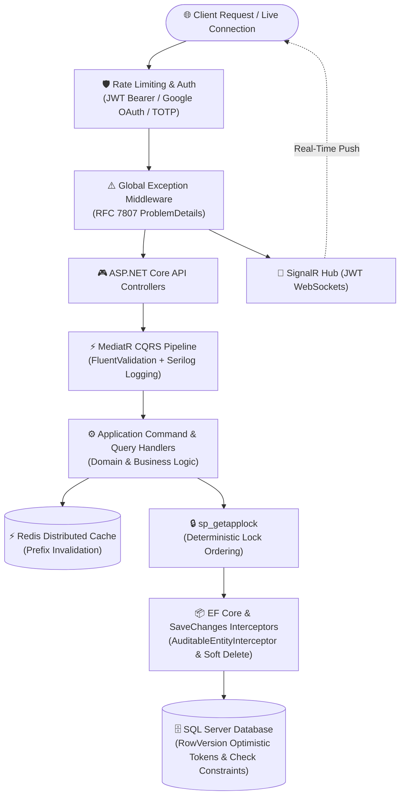

<div align="center">

# Hi there, I'm Abdurrahman Desouky 👋

### .NET Backend & Software Engineer | Clean Architecture • High-Concurrency APIs • Distributed Systems

<p align="center">
  <a href="https://git.io/typing-svg">
    
  </a>
</p>

<p align="center">
  
  
  
  
  
  
</p>

<p align="center">
  <a href="https://github.com/AbdurrahmanHassouna"></a>
  <a href="https://linkedin.com/in/AbdurrahmanHassouna"></a>
  <a href="mailto:AbdurrahmanHassouna@gmail.com"></a>
  
  
  
  
</p>

</div>

---

## ⚡ About Me & Engineering Focus

I am a **.NET Backend & Software Engineer** passionate about architecting scalable, resilient, and enterprise-grade distributed systems. My engineering philosophy centers on clean code, SOLID principles, deterministic concurrency control under heavy load, and robust security posture.

```
┌────────────────────────────────────────────────────────────────────────────────────────┐
│                               ENGINEERING SPECIALIZATIONS                               │
│  .NET & C#   •   Clean Architecture   •   CQRS (MediatR)   •   SOLID Principles & OOP  │
│  Redis Caching • SignalR (WebSockets) • sp_getapplock & rowversion • JWT & TOTP Auth   │
└────────────────────────────────────────────────────────────────────────────────────────┘
```

### 🎓 Education & Intensive Training

- **Web Development in .NET Specialization** — *Information Technology Institute (ITI)*
  - Intensive practical training covering **C#**, **Advanced OOP**, **ASP.NET Core**, **EF Core**, **SQL Server**, and **MVC** design patterns.
- **B.Sc. in Computer Science** — *Beni-Suef University*
  - Comprehensive foundational coursework: **Data Structures & Algorithms**, **OOP**, **Database Systems**, **Software Engineering**, and **Computer Networks**.

### 🏛️ Core Pillars & Technical Capabilities

- **Clean & Layered Backend Architecture (.NET & ASP.NET Core)**
  - Designing modular enterprise backends utilizing **Clean Architecture**, **4-Tier Layered Architecture**, and **CQRS** patterns powered by **MediatR**.
  - Enforcing strict boundary separation between Domain, Application, Infrastructure, and Presentation layers with zero leaky abstractions.
  - Applying **SOLID principles**, robust **Dependency Injection**, and **FluentValidation** pipeline behaviors for clean cross-cutting validation and decoupling.

- **Concurrency-Safe Transactions & Scheduling**
  - Tackling high-contention race conditions in mission-critical transactions (e.g., sports venue booking engines, resource reservations).
  - Implementing **dual-layer concurrency control**: pairing database-level pessimistic application locks via SQL Server **`sp_getapplock`** (with deterministic lock ordering to prevent deadlocks) with EF Core optimistic concurrency tokens (**`rowversion`** / `byte[]`) and database check constraints to eliminate double-booking.
  - Designing timezone-aware **midnight-crossing scheduling engines** handling UTC normalization, temporal consistency, and split-interval slots across operating day transitions.

- **Real-Time Communication & Distributed Caching**
  - Implementing low-latency bidirectional messaging using **ASP.NET Core SignalR (WebSockets)** secured with query-string JWT handshakes for instant notifications and live updates.
  - Eliminating database query bottlenecks through **Redis** distributed caching patterns (Cache-Aside, Write-Through).
  - Formulating structured **prefix-based cache invalidation strategies** (e.g., entity-targeted key prefixes) ensuring zero stale reads while sustaining sub-millisecond lookup latencies.

- **Identity, TOTP Security & API Reliability**
  - Securing APIs with **ASP.NET Core Identity**, stateless **JWT Bearer Authentication**, **Google OAuth 2.0**, and custom **TOTP (Time-Based One-Time Password)** token providers for multi-factor authentication (MFA).
  - Enforcing granular authorization policies using Role-Based (RBAC) and Claim/Policy-Based Access Control.
  - Hardening production endpoints with IP- and user-partitioned **Rate Limiting** (sliding window / token bucket) and standardized **RFC 7807 `ProblemDetails`** global exception handling middleware.

---

## 🛠️ Tech Stack & Architectural Competencies

<table>
  <thead>
    <tr>
      <th width="28%">Domain</th>
      <th width="72%">Technologies & Architectural Capabilities</th>
    </tr>
  </thead>
  <tbody>
    <tr>
      <td><strong>Backend, Languages & Real-Time</strong></td>
      <td>
        
        
        
        
        
        
        
        
        
      </td>
    </tr>
    <tr>
      <td><strong>Architecture & Principles</strong></td>
      <td>
        
        
        
        
        
        
        
        
        
      </td>
    </tr>
    <tr>
      <td><strong>Database, Caching & Concurrency</strong></td>
      <td>
        
        
        
        
        
        
      </td>
    </tr>
    <tr>
      <td><strong>Security, Logging & DevOps</strong></td>
      <td>
        
        
        
        
        
        
        
        
        
        
        
        
        
      </td>
    </tr>
  </tbody>
</table>

### 🏛️ End-to-End Execution Flow & Architectural Pipeline

Below is the production-grade request lifecycle and concurrency architecture implemented across my .NET Clean & Layered solutions:



> 💡 **Architectural Tenets:**
> - **Clean Layered Separation & SOLID:** Core business logic, entities, and application interfaces remain strictly decoupled from UI frameworks, ORM implementations, and external SDKs via Dependency Injection.
> - **Deterministic Concurrency & Zero-Overbooking:** Critical booking and reservation transactions are guarded by transaction-scoped `sp_getapplock` with deterministic lock ordering (preventing deadlocks), EF Core `RowVersion` optimistic concurrency tokens, and database check constraints.
> - **Robust CQRS Pipeline & Standardized Diagnostics:** Cross-cutting validation (`FluentValidation`), structured logging (`Serilog`), and exception handling (`RFC 7807 ProblemDetails`) execute predictably in pipeline behaviors before core handlers run.
> - **Real-Time Communication & Distributed Caching:** Low-latency bi-directional messaging with **SignalR (WebSockets)** coupled with Redis cache-aside and prefix-based cache invalidation strategies to ensure data freshness and minimize database load.

---

## 🚀 Featured Engineering Projects

### ⚽ [PitchReserve](https://github.com/AbdurrahmanHassouna/PitchReserve) — Sports Pitch Reservation & Matchmaking API
> **Stack:** `ASP.NET Core Web API` • `EF Core` • `SQL Server` • `Redis` • `MediatR (CQRS)` • `FluentValidation` • `Serilog` • `Docker`

A production-grade sports venue reservation and matchmaking backend engineered for high-concurrency environments with zero double-booking tolerance.

* **Concurrency-Safe Booking:** Prevented double-bookings using SQL Server application locks (`sp_getapplock`) with deterministic lock ordering to avoid deadlocks, EF Core `rowversion` optimistic concurrency, and capacity check constraints.
* **Clean Architecture & CQRS:** Structured a 4-project solution (`Domain`, `Application`, `Infrastructure`, `API`) with MediatR commands/queries and a `FluentValidation` pipeline behavior, exposing 32 REST endpoints across 6 controllers.
* **Scheduling Engine:** Built Cairo-timezone-aware scheduling supporting operating hours that cross midnight, whole-hour slots, overlap detection, and a 24-hour cancellation policy.
* **Booking & Matchmaking Workflows:** Implemented owner approval and cash-on-arrival settlement states, public match discovery, join-request approval, and privacy-preserving projections that hide participant contact details.
* **Security & Operations:** Added IP/user-partitioned rate limiting, PBKDF2 password hashing, Redis caching with prefix-based invalidation, Serilog logging, and multi-stage Docker builds with Docker Compose (`API`, `SQL Server`, `Redis`).

---

### 🩺 [SkinCaAPI (`SkinCaLayered` & `SkinCaApp`)](https://github.com/AbdurrahmanHassouna/SkinCaLayered) — Telehealth Web API
> **Stack:** `ASP.NET Core Web API` • `EF Core` • `SQL Server` • `SignalR (WebSockets)` • `JWT` • `Custom Identity (TOTP)`  
> 🔗 **Live Demo:** [Swagger API Documentation](https://skinca.runasp.net/swagger)

A digital telehealth and dermatological consultation backend integrating automated diagnostic workflows with secure real-time communication.

* **Decoupled 4-Tier Architecture:** Architected the backend across `Presentation`, `Business Logic`, `Data Access`, and `Common` layers, with 12 service and 8 repository contracts wired via dependency injection (8 controllers, 45 endpoints).
* **Real-Time Telehealth Consultations:** Engineered a real-time messaging system for doctor-patient consultations using **ASP.NET Core SignalR (WebSockets)**, securing socket handshakes with JWT authentication and enabling multi-device synchronization.
* **Custom Identity & TOTP Security:** Developed a custom Identity token provider using time-based one-time password (**TOTP**) codes for secure password resets, tying verification tokens to user security credentials to invalidate stale codes.
* **Geospatial Clinic Discovery:** Implemented location-based clinic search using the **Haversine formula** to calculate distances within a 10 km radius, cross-referencing real-time operating schedules to display available nearby doctors.
* **API Reliability & Data Integrity:** Implemented global exception middleware returning **RFC 7807 `ProblemDetails`**, custom validation attributes, composite unique indexes, and automated UTC audit timestamps on save.

---

### 📚 [April Book Store (`BookStoreDotNetCore`)](https://github.com/AbdurrahmanHassouna/BookStoreDotNetCore) — E-Commerce Web Application
> **Stack:** `ASP.NET Core MVC` • `Entity Framework Core` • `SQL Server` • `ASP.NET Core Identity` • `Google OAuth` • `jQuery AJAX`

An enterprise e-commerce web application built with strict layer separation and comprehensive lifecycle auditing.

* **Clean Architecture:** Structured the application into four layers (`Domain`, `Application`, `Infrastructure`, `Web`), isolating business rules from persistence through application service interfaces and ViewModel projections.
* **Interactive AJAX Shopping Cart:** Developed an interactive shopping cart engine using **jQuery AJAX** and server-rendered partial views, updating item quantities, prices, and live navbar badge counters without page reloads.
* **Atomic Checkout & Concurrency:** Engineered an atomic order checkout workflow wrapped in database transactions that validates stock levels, snapshots historical book prices into orders, and applies EF Core `rowversion` optimistic concurrency control.
* **Role-Based Access & Admin Portal:** Configured ASP.NET Core Identity with Google OAuth and policy-based authorization, featuring an admin dashboard with safeguards against deleting the `SuperAdmin` account and system roles.
* **Soft Deletes & Constraints:** Automated UTC timestamps and soft deletion via an EF Core `SaveChanges` interceptor, combined with database check constraints ensuring inventory never drops below zero.

---

### 📊 Repository Architecture & Engineering Matrix

| Repository | Architecture Pattern | Technology Stack | Key Engineering Solved |
| :--- | :--- | :--- | :--- |
| **[PitchReserve](https://github.com/AbdurrahmanHassouna/PitchReserve)** | Clean Architecture + CQRS | .NET, EF Core, SQL Server, Redis, MediatR, Docker | Zero double-bookings via `sp_getapplock` + `rowversion` (deterministic lock ordering), Cairo midnight-crossing scheduling, Redis prefix-based cache invalidation, partitioned rate limiting |
| **[SkinCaLayered](https://github.com/AbdurrahmanHassouna/SkinCaLayered)** | 4-Tier Layered Architecture | ASP.NET Core Web API, EF Core, SignalR, SQL Server, JWT, TOTP | SignalR real-time consultation messaging with JWT auth, custom TOTP token provider, Haversine geospatial 10km clinic discovery, RFC 7807 ProblemDetails |
| **[BookStoreDotNetCore](https://github.com/AbdurrahmanHassouna/BookStoreDotNetCore)** | 4-Layer Clean Architecture | ASP.NET Core MVC, EF Core, SQL Server, Identity, Google OAuth, jQuery AJAX | Interactive jQuery AJAX shopping cart, atomic order checkout transactions with `rowversion`, SaveChanges soft-delete & audit interceptor, SuperAdmin deletion protection |
| **[SkinCaApp](https://github.com/AbdurrahmanHassouna/SkinCaApp)** | Client / Presentation Architecture | Mobile App / Client Framework, REST Client, SignalR Client | Real-time patient-doctor consultation chat UI, secure medical image uploads, live doctor availability status, RESTful API consumption |
| **[BookStoreDotNetFramework](https://github.com/AbdurrahmanHassouna/BookStoreDotNetFramework)** | Classic 3-Tier MVC Architecture | ASP.NET MVC, .NET Framework, SQL Server | Relational catalog management, shopping cart session lifecycle, classic enterprise MVC design patterns |

---

<h2 align="center">📊 GitHub Activity & Metrics</h2>

<div align="center">
  <a href="https://github.com/AbdurrahmanHassouna">
    
  </a>
  <a href="https://github.com/AbdurrahmanHassouna">
    
  </a>
</div>
<br />
<div align="center">
  <a href="https://github.com/AbdurrahmanHassouna">
    
  </a>
</div>

<br />

---

<h2 align="center">🤝 Let's Connect & Collaborate</h2>

<p align="center">
  Whether you want to discuss backend architecture, concurrency-safe APIs, open-source projects, or potential engineering opportunities—feel free to reach out!
</p>

<p align="center">
  <a href="https://linkedin.com/in/AbdurrahmanHassouna" target="_blank">
    
  </a>
  &nbsp;&nbsp;
  <a href="https://github.com/AbdurrahmanHassouna" target="_blank">
    
  </a>
  &nbsp;&nbsp;
  <a href="mailto:AbdurrahmanHassouna@gmail.com">
    
  </a>
</p>

<br />

> ### 💼 Open to Opportunities
>
> 🎯 **Actively seeking roles as a .NET Backend Engineer / Software Engineer.**  
> Dedicated to building high-concurrency APIs, resilient distributed backends, and reliable solutions using .NET, Clean Architecture, and enterprise engineering practices.
>
> *Always enthusiastic about backend system design collaborations and engineering discussions!*

<br />

<div align="center">
  <sub>Crafted with passion for clean code & scalable systems • © Abdurrahman Desouky</sub>
</div>
