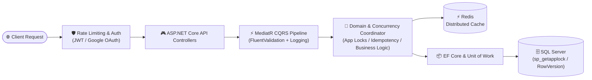

<div align="center">

# Hi there, I'm Abdurrahman Hassouna 👋

### .NET Backend & Software Engineer | Clean Architecture • High-Concurrency APIs • Distributed Systems

<p align="center">
  <a href="https://git.io/typing-svg">
    
  </a>
</p>

<p align="center">
  
  
  
  
  
  
</p>

<p align="center">
  <a href="https://github.com/AbdurrahmanHassouna"></a>
  <a href="https://linkedin.com/in/abdurrahman-hassouna"></a>
  
  
  
</p>

</div>

---

## ⚡ About Me & Engineering Focus

I am a **.NET Backend & Software Engineer** passionate about architecting scalable, resilient, and enterprise-grade distributed systems. My engineering philosophy centers on clean code, domain isolation, deterministic concurrency control under heavy load, and robust security posture.

```
┌────────────────────────────────────────────────────────────────────────────────────────┐
│                               ENGINEERING SPECIALIZATIONS                               │
│    .NET & C#   •   Clean Architecture   •   CQRS / MediatR   •  Domain-Driven Design    │
│  Distributed Caching (Redis) • sp_getapplock & rowversion  •  JWT / OAuth2 / Identity  │
└────────────────────────────────────────────────────────────────────────────────────────┘
```

### 🏛️ Core Pillars & Technical Capabilities

- **Production-Grade Backend Architecture (.NET & ASP.NET Core)**
  - Designing modular enterprise backends utilizing **Clean Architecture**, **Domain-Driven Design (DDD)**, and **CQRS** patterns powered by **MediatR**.
  - Enforcing strict boundary separation between Domain, Application, Infrastructure, and Presentation layers with zero leaky abstractions.
  - Decoupling business rules into rich domain aggregates, entity state transitions, and asynchronous domain event handlers.

- **High-Concurrency, Locking & Data Integrity**
  - Tackling high-contention race conditions in mission-critical transactions (e.g., booking engines, inventory allocation, financial workflows).
  - Implementing **dual-layer concurrency control**: pairing database-level pessimistic application locks via SQL Server **`sp_getapplock`** with EF Core optimistic concurrency tokens (**`rowversion`**) to prevent double-booking and phantom updates.
  - Designing robust **multi-timezone engines** handling complex daylight saving time (DST) shifts, UTC normalization, and midnight-crossing schedules across distributed nodes.

- **Distributed Caching & High-Throughput Scaling**
  - Eliminating database bottlenecks through **Redis** distributed caching patterns (Cache-Aside, Write-Through).
  - Formulating structured **prefix-based cache invalidation strategies** to ensure zero stale reads while maintaining near-instant lookup latencies.

- **Enterprise Security, Authentication & Traffic Governance**
  - Securing APIs with **ASP.NET Core Identity**, stateless **JWT Bearer Authentication**, and **OAuth 2.0** flows.
  - Enforcing granular authorization policies using Role-Based (RBAC) and Claim/Policy-Based Access Control.
  - Implementing partitioned **Rate Limiting** to protect endpoints against brute-force attacks, DDoS, and noisy-neighbor exhaustion.

---

## 🛠️ Tech Stack & Architectural Competencies

<table>
  <thead>
    <tr>
      <th width="28%">Domain</th>
      <th width="72%">Technologies & Architectural Capabilities</th>
    </tr>
  </thead>
  <tbody>
    <tr>
      <td><strong>Languages & Core</strong></td>
      <td>
        
        
        
        
        
        
        
        
      </td>
    </tr>
    <tr>
      <td><strong>Architecture & Patterns</strong></td>
      <td>
        
        
        
        
        
        
        
      </td>
    </tr>
    <tr>
      <td><strong>Data, Caching & Concurrency</strong></td>
      <td>
        
        
        
        
        
      </td>
    </tr>
    <tr>
      <td><strong>Security, DevOps & Tooling</strong></td>
      <td>
        
        
        
        
        
        
        
        
        
        
      </td>
    </tr>
  </tbody>
</table>

### 🏛️ End-to-End Clean Architecture Execution Flow

Below is the request lifecycle implemented across my production-grade .NET Clean Architecture solutions:



> 💡 **Architectural Tenets:**
> - **Strict Domain Isolation:** Business rules and domain invariants remain independent of frameworks, external databases, or third-party SDKs.
> - **Zero-Overbooking Guarantees:** Critical booking/reservation transactions are guarded with transaction-scoped `sp_getapplock` and EF Core `RowVersion` optimistic tokens.
> - **Resilient CQRS Request Pipeline:** Validation, logging, and performance telemetry execute seamlessly via MediatR pipeline behaviors before domain handlers are invoked.
> - **High-Efficiency Distributed Caching:** Cache-aside pattern via Redis with prefix-based invalidation policies prevents stale reads and minimizes SQL Server query load.

---

## 🚀 Featured Engineering Projects

### ⚽ [PitchReserve](https://github.com/AbdurrahmanHassouna/PitchReserve) — High-Concurrency Sports Venue Booking Engine
> **Stack:** `.NET` • `C#` • `Clean Architecture` • `CQRS (MediatR)` • `EF Core` • `SQL Server` • `Redis` • `Docker`

A production-grade sports venue reservation engine architected for zero double-booking tolerance under high-concurrency traffic spikes.

* **Dual-Layer Concurrency Control:**
  * **Database-Level Synchronization:** Custom `SqlServerTransactionCoordinator` utilizing `sp_getapplock` to serialize concurrent reservation requests for the exact same pitch and time slot.
  * **Optimistic Token Validation:** EF Core `rowversion` concurrency tokens to eliminate race conditions and prevent ghost updates.
* **Complex Scheduling & Timezone Engine:** Custom `Africa/Cairo` timezone engine with full support for midnight-crossing slots, dynamic blackout periods, and variable slot durations.
* **Two-Stage Cash Settlement State Machine:** Deterministic finite-state workflow governing reservations, deposit verifications, operator confirmations, and automated timeout releases.
* **Performance & Protection:** Redis distributed caching with prefix-based bulk invalidation strategies alongside partitioned rate limiting to safeguard against booking abuse.
* **Comprehensive REST API:** 32 cleanly segregated CQRS endpoints with cross-cutting pipeline behaviors for validation and structured logging.

---

### 📚 [BookStoreDotNetCore (AprilBookStore)](https://github.com/AbdurrahmanHassouna/BookStoreDotNetCore) — Enterprise Clean Architecture E-Commerce Platform
> **Stack:** `.NET` • `ASP.NET Core MVC` • `EF Core` • `ASP.NET Core Identity` • `Google OAuth 2.0` • `SQL Server`

An enterprise e-commerce platform built around strict separation of concerns and maintainable domain-driven design principles.

* **4-Layer Clean Architecture:** Strictly decoupled into `Domain`, `Application`, `Infrastructure`, and `Web` layers, guaranteeing testability and preventing infrastructure leakage into core business rules.
* **Auditing & Soft-Delete Pipeline:** Custom EF Core `AuditableEntityInterceptor` for automated temporal tracking (`CreatedAt`, `ModifiedAt`, `CreatedBy`) combined with global query filters for soft-delete enforcement.
* **Identity & Granular Authorization:** Multi-tier role- and policy-based access control (`SuperAdmin`, `Admin`, `User`) coupled with Google OAuth 2.0 external authentication.
* **Automated Data Lifecycle:** Self-executing database migration and deterministic data-seeding pipeline for zero-friction local and staging deployments.

---

### 🩺 [SkinCA Platform (`SkinCaLayered` & `SkinCaApp`)](https://github.com/AbdurrahmanHassouna/SkinCaLayered) — AI-Assisted Dermatology & Healthcare Ecosystem
> **Stack:** `ASP.NET Core` • `N-Tier Layered Architecture` • `EF Core` • `JWT Bearer Auth` • `RESTful API` • `Swagger/OpenAPI`

A digital healthcare back-end ecosystem integrating automated diagnostic classification with real-time tele-health workflows.

* **AI/ML Diagnostics Integration:** Secure REST pipeline interfacing with machine learning models for automated dermatological skin lesion analysis and risk assessment.
* **Role-Segregated Medical Auth:** Stateless JWT authentication securing confidential medical records across distinct patient and physician personas.
* **Geospatial Doctor Directory:** Location-aware provider directory enabling patients to discover and filter verified dermatologists by proximity and specialty.
* **Real-Time Clinical Chat API:** Direct patient-to-physician communication channels supporting consultation records and attachment handling.
* **OpenAPI Specification:** Full Swagger/OpenAPI documentation defining explicit contracts, request schemas, and token authorization flows.

---

### 📊 Repository Architecture & Engineering Matrix

| Repository | Architecture Pattern | Technology Stack | Key Engineering Solved |
| :--- | :--- | :--- | :--- |
| **[PitchReserve](https://github.com/AbdurrahmanHassouna/PitchReserve)** | Clean Architecture + CQRS | .NET, EF Core, SQL Server, Redis, Docker | Zero double-bookings via `sp_getapplock` + `rowversion`, midnight-crossing timezone logic, Redis cache prefix invalidation |
| **[BookStoreDotNetCore](https://github.com/AbdurrahmanHassouna/BookStoreDotNetCore)** | 4-Layer Clean Architecture | .NET, ASP.NET Core MVC, EF Core, Identity, Google OAuth | Automated `AuditableEntityInterceptor`, global soft deletes, multi-tier RBAC (`SuperAdmin`/`Admin`/`User`), migration seeding |
| **[SkinCaLayered](https://github.com/AbdurrahmanHassouna/SkinCaLayered)** | N-Tier Layered Architecture | ASP.NET Core, EF Core, JWT, Swagger/OpenAPI | Machine learning lesion analysis pipeline, medical JWT auth, geospatial doctor directory search |
| **[SkinCaApp](https://github.com/AbdurrahmanHassouna/SkinCaApp)** | RESTful Healthcare API | ASP.NET Core, EF Core, Identity, JWT | AI-assisted skin lesion classification endpoints, clinical identity & authentication |
| **[BookStoreDotNetFramework](https://github.com/AbdurrahmanHassouna/BookStoreDotNetFramework)** | Classic 3-Tier MVC | ASP.NET MVC, .NET Framework, SQL Server | Relational catalog management, shopping cart session lifecycle, classic .NET enterprise web architecture |

---

<h2 align="center">📊 GitHub Activity & Metrics</h2>

<div align="center">
  <a href="https://github.com/AbdurrahmanHassouna">
    
  </a>
  <a href="https://github.com/AbdurrahmanHassouna">
    
  </a>
</div>
<br />
<div align="center">
  <a href="https://github.com/AbdurrahmanHassouna">
    
  </a>
</div>

<br />

---

<h2 align="center">🤝 Let's Connect & Collaborate</h2>

<p align="center">
  Whether you want to discuss backend architecture, distributed systems, open-source projects, or potential engineering opportunities—feel free to reach out!
</p>

<p align="center">
  <a href="https://www.linkedin.com/in/abdurrahman-hassouna" target="_blank">
    
  </a>
  &nbsp;&nbsp;
  <a href="https://github.com/AbdurrahmanHassouna" target="_blank">
    
  </a>
</p>

<br />

> ### 💼 Open to Opportunities
>
> 🎯 **Actively seeking roles as a .NET Backend Engineer / Software Engineer.**  
> Dedicated to building high-performance APIs, robust distributed systems, and reliable cloud-native solutions using modern .NET, Clean Architecture, and best engineering practices.
>
> *Always enthusiastic about backend system design collaborations and engineering discussions!*

<br />

<div align="center">
  <sub>Crafted with passion for clean code & scalable systems • © Abdurrahman Hassouna</sub>
</div>
